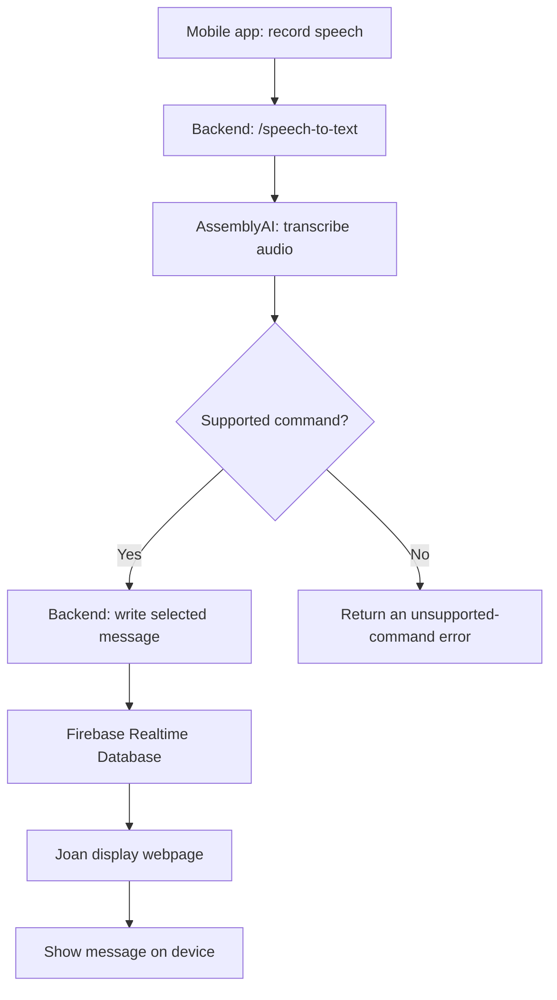

# GetJoan Visionect Project

A diploma thesis prototype for sending predefined workplace status messages to a Joan display through a React Native mobile application. Users can select a message manually or issue a voice command, for example to indicate that they will be late to a meeting. The selected message is delivered through a backend service and displayed using Firebase Realtime Database.

## Project Overview

[Joan](https://getjoan.com/) is a workplace and meeting-room management solution with room displays and calendar integrations. This project explores an additional communication workflow: allowing a user to send short, predefined status messages from a mobile device to a webpage shown on a Joan device.

The prototype is intended for workplace scenarios involving meeting participants, office staff, receptionists, and visitors. For example, a meeting participant delayed in traffic can send an **"I'll be late"** message without having to compose a full text message.

This repository contains an academic prototype developed for a diploma thesis. It is not presented as an official Joan product or a production-ready integration.

## Features

- **Firebase Authentication** for user authentication in the mobile application.
- **Voice-based messaging:** record speech in the mobile app, transcribe it using AssemblyAI, and match the transcript to a supported command using backend keyword-based logic.
- **Manual messaging:** select a predefined message without recording audio.
- **Real-time display updates:** publish the selected message to Firebase Realtime Database for the display webpage to receive.
- **Notifications and message history:** provide notification and history functionality backed by Firebase.

Supported message categories include:

- **I'll be late**
- **Meeting started**
- **Arrived at location**
- **Need assistance**

Recognition is limited to supported commands and their implemented options. Natural-language phrases that do not match the backend's keyword rules may be rejected even when speech transcription succeeds.

## System Architecture

The repository consists of three applications:

| Component | Technology | Responsibility |
| --- | --- | --- |
| Mobile client | React Native, Expo SDK 54 | Authentication, voice recording, manual message selection, notifications, and history |
| Backend server | Node.js, Express, TypeScript | Speech-to-text API, keyword-based command recognition, and Firebase message writes |
| Joan display webpage | React, Vite | Listens for Firebase updates and renders the most recent message |

### Voice message flow



### Manual message flow

1. The user selects a predefined message in the mobile app.
2. The mobile app sends the selection to the backend.
3. The backend writes the message to Firebase Realtime Database.
4. The display webpage receives the database change and updates its content.

The display webpage is opened on the Joan device using its webpage URL. The application uses the `message` key in Firebase Realtime Database for the currently displayed message.

## Repository Structure

```text
getjoan-visionect-project/
├── client/                # Expo React Native mobile application
├── server/                # Express and TypeScript backend
├── joan-display-webpage/  # React and Vite display interface
└── README.md              # Project documentation
```

Each application also has its own README with component-specific information:

- [`client/README.md`](client/README.md)
- [`server/README.md`](server/README.md)
- [`joan-display-webpage/README.md`](joan-display-webpage/README.md)

## Prerequisites

- Node.js 18 or later and npm
- A compatible Android device for mobile testing (or another supported Expo development environment)
- **Expo Go compatible with Expo SDK 54**, if using Expo Go
- Firebase project configuration for authentication and Realtime Database
- An AssemblyAI API key for voice transcription
- Network connectivity between the mobile app and backend
- A URL accessible to the Joan device for the display webpage

## Installation and Local Development

Open three terminals from the repository root, one for each application.

### 1. Backend server

```bash
cd server
npm install
npm run dev
```

The server uses a local environment file at `server/.env`. The following settings were identified for the project:

```dotenv
PORT=4000
ASSEMBLYAI_API_KEY=your_assemblyai_api_key
```

Replace the placeholder with your own key. Other Firebase or application-specific configuration must be supplied according to the corresponding source files and subproject documentation; credentials are not included here.

### 2. Mobile client

```bash
cd client
npm install
npx expo start
```

This project uses **Expo SDK 54**. When testing with Expo Go, install an SDK 54-compatible version from the [official Expo Go download page](https://expo.dev/go). An incompatible Expo Go version cannot launch the project without changing the environment.

If local networking prevents the device from reaching the Expo development server, tunnel mode can be used:

```bash
npx expo start --clear --tunnel
```

The phone must also be able to reach the backend API. If needed, configure the optional mobile API address through `EXPO_PUBLIC_API_BASE`, using an address reachable from the test device. Do not use `localhost` to refer to the computer's backend from a physical phone.

### 3. Joan display webpage

```bash
cd joan-display-webpage
npm install
npm run dev
```

The Vite development server serves the display webpage locally. To show it on a Joan device, the device must be configured to access a reachable URL for the webpage. Deployment and device-specific URL configuration depend on the test environment and are not covered by these local startup commands.

## Firebase and Configuration

Firebase is used for:

- Authentication in the mobile application
- The latest message displayed by the Joan webpage
- Application notifications
- Message history

Firebase configuration currently exists in source files across the applications. Before sharing or deploying this project, review the Firebase configuration, database security rules, and access permissions. Keep private keys, service account credentials, and API tokens out of version control. A client-side Firebase configuration alone is not a replacement for secure authentication and database rules.

Configuration values and secrets are intentionally not documented in this README.

## Testing

The prototype has been manually tested using a physical Android phone. Reported working functionality includes sending supported voice commands, submitting manual messages, updating the display through Firebase, and saving notifications and message history.

These are development tests of the prototype, not a claim of comprehensive automated testing, performance validation, or production certification.

## Scope and Limitations

- The system is a **working prototype / proof of concept** developed for a diploma thesis.
- Voice recognition uses transcription followed by **keyword-based command matching**; it does not interpret every natural-language request.
- Messages are restricted to the categories and options implemented in the backend.
- Voice transcription requires access to the AssemblyAI service.
- Real-time updates and authentication depend on the configured Firebase services and network connectivity.
- Successful use on an actual Joan device depends on the device's ability to load the display webpage URL.
- The project has been tested on a physical phone; broader device compatibility and production deployment have not been established.

## Academic Context

This repository documents an experimental approach to workplace communication using a mobile application, speech-to-text processing, predefined commands, and a network-connected display. Its primary purpose is to demonstrate the end-to-end implementation and evaluate its feasibility in the context of a diploma thesis.

## Third-Party Services

- [Joan](https://getjoan.com/) — workplace and meeting-room display platform
- [Expo](https://expo.dev/) — React Native development tooling
- [AssemblyAI](https://www.assemblyai.com/) — speech transcription service
- [Firebase](https://firebase.google.com/) — authentication and real-time data services

Joan and other third-party product names belong to their respective owners.