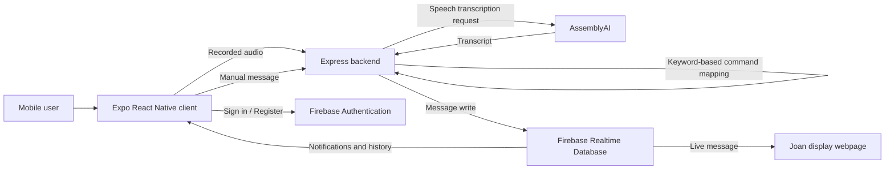

# GetJoan Mobile Client

## Overview

The GetJoan Mobile Client is an Expo React Native application developed as part of a diploma thesis project exploring mobile communication with a Joan display. It allows users to select and send predefined messages manually or through spoken commands. The mobile application communicates with a separate Node.js backend, which processes voice input and forwards messages to Firebase Realtime Database. A webpage displayed on the Joan device retrieves the current message from Firebase.

This application is a working academic prototype, not an official Joan mobile application or a production-ready integration.

## Features

- User registration and login with Firebase Authentication.
- Manual selection and sending of supported messages.
- Audio recording and voice-driven command submission.
- Speech transcription through the backend's AssemblyAI integration.
- Keyword-based mapping of transcripts to supported commands on the backend.
- Notifications and message history backed by Firebase Realtime Database.
- File-based navigation using Expo Router.

Supported message categories include "I'll be late", "Meeting started", "Arrived at location", and "Need assistance". Available options and exact message text are determined by the application's command definitions.

## Technology Stack

| Technology | Purpose |
| --- | --- |
| Expo SDK 54 | React Native development and execution |
| React Native + TypeScript | Mobile application and typed source code |
| Expo Router | File-based screens and navigation |
| Firebase Authentication | User registration and sign-in |
| Firebase Realtime Database | Notifications, history, and message data |
| Node.js / Express backend | Manual message relay and voice-processing API |
| AssemblyAI (via backend) | Speech transcription |

## System Architecture



The client does not directly perform speech recognition: it records audio and sends it to the backend. The backend performs transcription and command matching. In the manual flow, the client sends a selected message to the backend instead.

## Prerequisites

- Node.js 18 or later, subject to the project's installed dependency requirements.
- npm.
- Android or iOS device with an Expo Go build compatible with **Expo SDK 54**, or a suitable emulator/simulator.
- A running GetJoan backend configured with its required services.
- Firebase project configuration for the existing application.

For physical-device testing, the phone must be able to reach the backend. When using a LAN address, the computer and phone should generally be on the same reachable network.

## Installation

From the `client/` directory:

```bash
npm install
```

## Running the Application

Start the development server:

```bash
npm run start
```

Alternatively:

```bash
npm run android
npm run ios
npm run web
```

These commands depend on the platforms and tools available on the development machine. Mobile features, particularly recording and native integrations, should be validated on a supported physical device.

To clear Metro's cache during troubleshooting:

```bash
npx expo start --clear
```

For network connectivity issues, Expo's tunnel mode may help:

```bash
npx expo start --clear --tunnel
```

**SDK compatibility:** This project uses **Expo SDK 54**. Install an Expo Go version compatible with SDK 54; do not upgrade the project to a newer SDK solely to resolve an Expo Go mismatch. Android device builds for particular SDK versions can be obtained from the official [Expo Go downloads](https://expo.dev/go) page.

## Backend API Configuration

The client determines its backend base URL in `functions/apiBase.ts`. The documented development defaults are:

| Environment | Example backend URL |
| --- | --- |
| Android emulator | `http://10.0.2.2:4000` |
| iOS simulator | `http://localhost:4000` |
| Physical device | Address inferred from the Metro host when possible |

An optional environment variable can provide an explicit fallback:

```env
EXPO_PUBLIC_API_BASE=http://192.168.1.20:4000
```

Replace the example IP address with the computer's reachable LAN address. The backend must be running and reachable at that address. A URL that works on the development computer is not necessarily accessible from a phone.

Variables prefixed with `EXPO_PUBLIC_` are included in the client application and must **not** contain secrets.

## Application Workflows

### Authentication

Users sign in or register through Firebase Authentication. Application layout and authentication-related navigation are managed in `app/_layout.tsx`.

### Manual Messaging

1. A user chooses a supported message in the mobile application.
2. The client submits the message to the backend.
3. The backend writes the message to Firebase Realtime Database.
4. The Joan display webpage reads the updated message and refreshes its displayed content.

### Voice Commands

1. The user records a spoken instruction in the mobile app.
2. The client sends recorded audio to the backend's `/speech-to-text` endpoint.
3. The backend uses AssemblyAI to obtain a transcript.
4. Server-side keyword matching attempts to identify a supported command.
5. When a valid command is recognized, the server writes the message to Firebase.
6. The Joan display webpage shows the new message.

Speech transcription does not guarantee that a command will be recognized. For example, "I will wait five minutes" does not necessarily express the same supported intent as "I will be five minutes late". Unsupported or ambiguous commands may be rejected by the backend.

### Notifications and History

The client includes views for notifications and message history using Firebase Realtime Database. These allow users to review application activity and previously sent messages, subject to the current implementation and database configuration.

## Project Structure

Key implementation files include:

```text
client/
├── app/
│   ├── _layout.tsx            # Root layout and authentication navigation
│   └── (tabs)/
│       └── index.tsx         # Main application screen
├── functions/
│   ├── apiBase.ts            # Backend URL resolution
│   ├── recordSpeech.tsx      # Audio recording helpers
│   └── transcribeSpeech.tsx  # Speech request handling
└── README.md
```

This outline highlights selected files rather than the complete directory tree.

## Available npm Scripts

| Command | Description |
| --- | --- |
| `npm run start` | Start the Expo development server |
| `npm run android` | Launch the Android target |
| `npm run ios` | Launch the iOS target |
| `npm run web` | Start the web target |
| `npm run lint` | Run configured lint checks |
| `npm run reset-project` | Run the scaffold reset script; not needed for normal use |

**Caution:** Avoid running `npm run reset-project` on an active thesis project without first inspecting the script and backing up or committing changes.

## Testing

The working prototype has been exercised on a physical Android phone using Expo Go. The tested end-to-end behavior includes voice-command submission, manual messaging, Firebase updates, notifications, and message history. This is manual functional testing, not evidence of full automated test coverage or production reliability.

For reproducibility, record the tested phone model, Android version, Expo Go version, backend environment, and results in the thesis or a separate testing report.

## Limitations

- Speech-command recognition is limited to the supported command definitions and keyword-based matching rules.
- Successful transcription may still produce an unrecognized command.
- The client depends on network access to the backend and Firebase services.
- Physical-device development requires compatible Expo Go and reachable backend configuration.
- The system is an academic prototype and has not been presented as production-hardened, security-audited, or broadly device-tested.

## Security and Configuration Notes

Firebase client configuration is currently included in source files. Firebase web/mobile configuration identifiers are not substitutes for access control: enforce appropriate Firebase Authentication and Realtime Database security rules. Keep private service credentials, AssemblyAI API keys, and any server secrets exclusively on the backend and outside source control. Do not commit `.env` files containing secrets.

## Related Documentation

- [Project overview](../README.md)
- [Backend server](../server/README.md)
- [Joan display webpage](../joan-display-webpage/README.md)

## Academic Context

This application was created as part of a diploma thesis to demonstrate mobile-to-display communication through manual selection and voice input. Its goal is to validate the feasibility of the interaction and integration workflow, not to replace the official Joan platform.