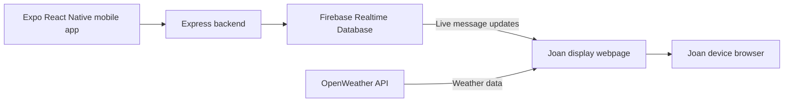

# Joan Display Webpage

## Overview

The Joan Display Webpage is a React and TypeScript application developed as part of the GetJoan communication system diploma thesis prototype. It provides a web-based interface intended to be displayed on a Joan device that can load a webpage from a URL.

The webpage presents the latest communication message received through Firebase Realtime Database, alongside the current date, time, and weather information for Ljubljana. It is the display component of a larger system consisting of an Expo React Native mobile application, an Express backend, and this webpage.

This project is a research and demonstration prototype rather than an official Joan application or a production-ready integration.

## Features

- **Live message display:** Listens for changes to the `message` key in Firebase Realtime Database and updates the displayed message.
- **Clock and date:** Shows the current time and date on the display.
- **Weather:** Retrieves weather information for Ljubljana using the OpenWeather API.
- **Web-based presentation:** Runs in a browser and can be accessed through a URL by a compatible display device.

## Technology Stack

| Technology | Purpose |
| --- | --- |
| React 19 | Display interface |
| TypeScript | Typed application code |
| Vite | Development server and production build tooling |
| Firebase Realtime Database SDK | Real-time message updates |
| OpenWeather API | Weather information |
| Lucide React | Interface icons |

## Role in the System

The display webpage does not transcribe speech or interpret voice commands. Those tasks are handled by the mobile application and backend.

The general communication flow is:

1. A user selects a predefined message or records a voice command in the mobile app.
2. The backend processes the request and writes the resulting message to Firebase Realtime Database.
3. The webpage listens for changes to the `message` key.
4. When the database value changes, the webpage updates the message shown on the display.



The webpage also updates its clock and date independently of message delivery.

## Project Structure

The main source files are:

```text
joan-display-webpage/
├── src/
│   ├── App.tsx          # Display interface, database listener, clock, and weather
│   └── firebase.ts      # Firebase initialization and exports
└── README.md
```

Other configuration and project files are generated or managed by the Vite application setup.

## Prerequisites

- Node.js 18 or later, subject to the requirements of the installed Vite version
- npm
- Access to the Firebase project used by the GetJoan prototype
- An OpenWeather API key for the weather feature

## Installation

From the monorepo root, navigate to this application:

```bash
cd joan-display-webpage
```

Install dependencies:

```bash
npm install
```

## Configuration

### Firebase Realtime Database

Firebase initialization is currently defined in `src/firebase.ts`. The webpage must be configured to access the same Firebase Realtime Database as the backend so that it can receive message updates.

The current display listener reads the `message` key. Database permissions must allow the intended access while preventing unauthorized modification or disclosure of data.

### OpenWeather API

Weather fetching is currently implemented in `src/App.tsx`, using an OpenWeather API key and a configured city (Ljubljana).

Do not commit private API credentials to a public repository. Before wider deployment, review the existing configuration and use an appropriate secret-management or server-side proxy approach for credentials that must not be exposed in a browser. Note that Vite client-side environment variables are included in the browser bundle and are not secret storage.

No additional environment variable names are assumed here because the current source configuration has not been independently verified.

## Running Locally

Start the Vite development server:

```bash
npm run dev
```

Open the local address shown in the terminal. By default, Vite commonly uses `http://localhost:5173`, but the actual URL may differ depending on configuration and available ports.

For the full communication workflow, the backend and mobile app should also be running and connected to the same Firebase project. See the root README for instructions.

## Production Build and Preview

Create an optimized build:

```bash
npm run build
```

Preview the built application locally:

```bash
npm run preview
```

The build output can be deployed to a suitable static web host. The display device must be able to reach the deployed URL, and the page must be compatible with its web rendering capabilities.

## Linting

Run the configured lint script:

```bash
npm run lint
```

## Display Deployment

In the thesis prototype, the Joan device is configured to load a URL for the webpage. This allows the device to render the same interface that can be viewed in a desktop browser.

Before using it on the device, verify that:

1. The webpage is reachable from the device's network.
2. Firebase can be accessed from the device environment.
3. The page layout renders correctly at the device's resolution.
4. Live database updates appear without manually refreshing the page.
5. The clock and weather data display as expected.

The exact steps for configuring the URL on a Joan device depend on its model and software configuration and are not documented here.

## Testing and Limitations

The overall GetJoan system has been tested as a working prototype using a physical mobile phone. The webpage is intended to display messages on a Joan device that loads its URL.

The following limitations should be considered:

- Display updates depend on a working Firebase connection and appropriate database access rules.
- Weather information depends on the availability of the OpenWeather service and valid API access.
- Device browser capabilities, network access, and screen dimensions can affect display behavior.
- The prototype does not establish production-readiness, comprehensive automated testing, or formal device compatibility certification.
- Firebase and weather configuration are currently located in source files and should be reviewed before public deployment.

## Related Documentation

- [`../README.md`](../README.md) — monorepo overview and full system architecture
- [`../server/README.md`](../server/README.md) — backend API, speech processing, and Firebase writes
- [`../client/README.md`](../client/README.md) — mobile application

## Academic Context

This webpage was developed as a component of a diploma thesis prototype exploring mobile and voice-controlled communication with a Joan display. It demonstrates how a web interface can reflect messages written to Firebase Realtime Database by another part of the system.

Joan and GetJoan are associated with their respective owners. This thesis prototype is described as an independent academic implementation, not an official product release.