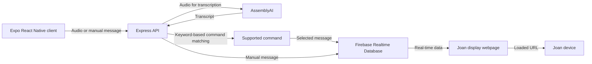

# GetJoan Server

Backend service for the GetJoan Visionect diploma thesis prototype. The server provides an API between the Expo React Native mobile application, the AssemblyAI transcription service, and Firebase Realtime Database. It processes recorded speech, matches transcriptions to predefined communication commands, and forwards selected messages for presentation on a Joan device through the project's display webpage.

This component is a research and development prototype, not a production-ready service or an official Joan API.

## Responsibilities

- Receive recorded audio from the mobile application.
- Request speech-to-text transcription using AssemblyAI.
- Interpret transcribed text using keyword-based command matching.
- Map recognized speech to a supported message category and option.
- Accept manually selected messages through a separate endpoint.
- Write selected messages to Firebase Realtime Database for the display webpage to retrieve.

User authentication, notification history, and the mobile user interface are parts of the wider project; they are not all implemented by this server component.

## Technology Stack

| Technology | Role |
| --- | --- |
| Node.js | JavaScript runtime |
| Express | HTTP API |
| TypeScript | Application code |
| ts-node (ESM) | TypeScript execution in the development setup |
| AssemblyAI REST API | Speech-to-text transcription |
| Firebase Realtime Database SDK | Message delivery and shared data storage |

## System Context



The backend performs speech-to-text processing, not text-to-speech synthesis. Audio is converted to text, after which the server attempts to identify one of the predefined commands.

## Prerequisites

- Node.js 18 or newer (as specified by the project's existing setup)
- npm
- An AssemblyAI API key
- Access to the Firebase project used by the application

## Installation

From the repository root:

```bash
cd server
npm install
```

## Configuration

Create a `.env` file inside the `server/` directory. The known settings from the existing setup are:

```env
PORT=4000
ASSEMBLYAI_API_KEY=your_assemblyai_api_key
```

The Firebase connection must also be configured for the intended project. Configuration details are implementation-specific and are not reproduced here. Refer to `firebase/db.ts` and the existing project configuration when setting up a new environment.

Do not commit actual API keys, credentials, or `.env` files to version control. Ensure that `.env` is ignored by Git.

## Running the Server

Development:

```bash
npm run dev
```

Alternatively, the existing project provides:

```bash
npm run start
```

With the default port setting, the API is available at:

```text
http://localhost:4000
```

When testing with Expo Go on a physical Android phone, `localhost` on the phone refers to the phone itself, not the development computer. Configure the client with a server address reachable from the phone, such as the computer's LAN address, and ensure the network and firewall allow access.

## API Endpoints

The endpoints below document the interface described in the current project README. Consult `index.ts` and the route handlers for exact validation rules and complete response schemas.

### `GET /`

Basic health-check endpoint used to confirm that the server is running.

### `POST /message`

Accepts a manually selected message and writes it to Firebase Realtime Database so that the display webpage can show it.

Example request:

```http
POST /message
Content-Type: application/json
```

```json
{
  "message": "Meeting started - Now"
}
```

The supported message wording and additional validation depend on the server implementation.

### `POST /speech-to-text`

Receives audio input, requests transcription through AssemblyAI, and maps the recognized text to one of the supported communication commands.

Example request with Base64-encoded audio:

```json
{
  "audioBase64": "<base64-audio>",
  "config": {
    "languageCode": "en"
  }
}
```

Alternative request with an audio URL:

```json
{
  "audioUrl": "https://example.com/audio.wav",
  "config": {
    "languageCode": "en"
  }
}
```

On successful command recognition, the server returns command information and writes the corresponding message to Firebase. A successful response observed during testing had the following structure:

```json
{
  "id": "<request-id>",
  "transcript": "I will be late 15 minutes.",
  "command": {
    "category": "I'll be late",
    "option": "15 minutes",
    "message": "I'll be late — 15 minutes"
  },
  "confidence": 0.96691835
}
```

The confidence shown here is an example from a test response, not a guaranteed value for any command.

If speech is transcribed but does not match a supported command, the API may return HTTP `422` with `command: null`, for example:

```json
{
  "id": "<request-id>",
  "transcript": "I will wait five minutes.",
  "command": null,
  "error": "No supported voice command was detected."
}
```

This distinction is important: successful transcription does not necessarily imply successful command recognition.

## Supported Command Categories

The prototype includes predefined communication categories such as:

- **I'll be late** — for notifying others about an expected delay.
- **Meeting started** — for indicating the start of a meeting.
- **Arrived at location** — for announcing arrival.
- **Need assistance** — for requesting help.

Available options, exact phrases, and supported wording are defined by the command-matching implementation. Refer to `functions/speechToCommand.ts` for the authoritative list instead of assuming unrestricted natural-language support.

## Speech Processing Workflow

1. The mobile client records audio and sends it to `POST /speech-to-text`.
2. The server submits the audio for transcription through AssemblyAI.
3. AssemblyAI returns the recognized transcript.
4. The server checks the transcript against the supported commands using keyword-based matching.
5. If a command is recognized, the server creates the predefined message and writes it to Firebase Realtime Database.
6. The Joan display webpage receives the updated message and shows it on the device.
7. If no command is recognized, the server reports that the spoken request could not be mapped to a supported action.

For example, "I will be late 15 minutes" was recognized during testing, while "I will wait five minutes" was transcribed successfully but did not match a supported command. This illustrates the difference between speech recognition and intent matching.

## Main Source Files

| File | Responsibility |
| --- | --- |
| `index.ts` | Express application and API routes |
| `functions/speechToText.ts` | AssemblyAI transcription workflow and associated message handling |
| `functions/speechToCommand.ts` | Mapping transcripts to supported commands |
| `firebase/db.ts` | Firebase database configuration |

## Testing and Known Limitations

The overall prototype has been tested with a physical Android phone running the Expo application. Voice commands, manual messages, and the Firebase-backed display workflow have been exercised during development.

Current limitations include:

- Command recognition is restricted to predefined categories and recognized keyword patterns.
- A correct transcription can still result in an unrecognized command.
- Speech recognition depends on an external AssemblyAI service and network access.
- The mobile client must be able to reach the API during real-device testing.
- The server and its configuration have not been documented or validated as a production deployment.

No automated test suite, deployment guarantees, or production security controls are claimed in this README.

## Related Documentation

- `../README.md` — system overview and monorepo setup
- `../client/README.md` — Expo React Native mobile application
- `../joan-display-webpage/README.md` — webpage rendered on the Joan display

## Academic Context

This backend was developed as part of a diploma thesis prototype exploring voice-assisted communication with a Joan display. Its primary purpose is to demonstrate the integration of mobile voice input, external speech transcription, keyword-based command interpretation, and real-time message presentation.